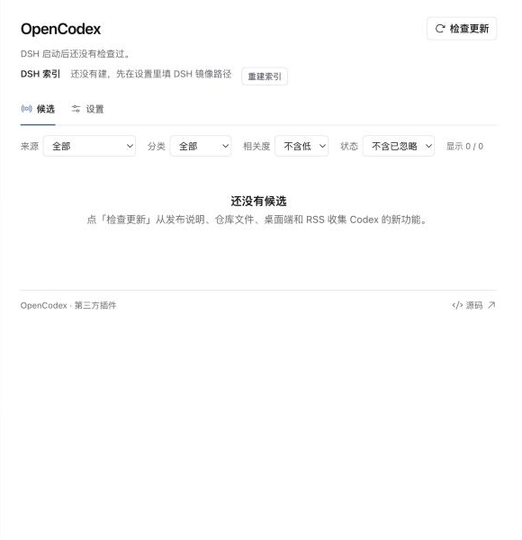
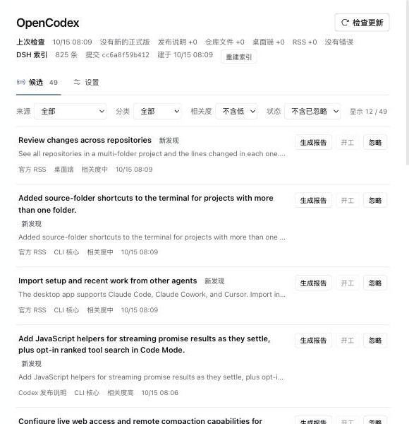
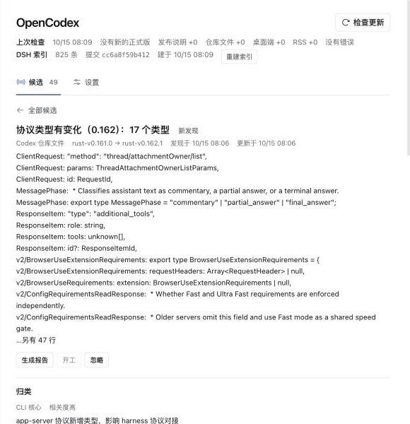

# OpenCodex

DeepSeek Harness（DSH）的第三方插件：每天收集 Codex 的更新，对照 DSH 源码写差距报告，再把选中的报告交给 DSH 创造模式会话去实现。





## 安装

### 要求

| 项 | 要求 |
| --- | --- |
| DSH | `dsh` CLI 0.2 系列：本插件对 `@deepseek-ai/dsh-*` 的 peer dependency 范围是 `>=0.2.0-rc.2 <0.3.0`，范围内的版本直接装，不用放行。验证过 0.2.1-alpha.2（`npm install -g @deepseek-ai/dsh@0.2.1-alpha.2`）；DSH 桌面端自带的 0.2.0-rc.2 运行时也能跑（实测采集、索引、归类正常；报告和开工用到的接口都在，但没在这个版本上跑过），见下面「装进桌面端」 |
| DSH 源码 | [deepseek-harness](https://github.com/deepseek-ai/deepseek-harness) 的一份 git 检出，生成报告和开工时必须有 |
| GitHub | 建议装 `gh` 并登录；没有时走匿名 REST，限额见[时限与上限](#时限与上限) |
| 桌面端 | 可选：macOS 上的 ChatGPT.app；没装就跳过这个来源 |
| 网络 | 访问 GitHub 和 developers.openai.com；有 `HTTPS_PROXY` 等环境变量时走它，否则在 macOS 上用系统 HTTPS 代理 |
| Node | 只在从源码打包时需要：22.19 以上，CI 用 24 |

### 安装包

从 [GitHub Releases](https://github.com/ZiyaZhang/opencodex/releases) 下载 `dsh-opencodex-0.3.1.tgz`，用 `shasum -a 256` 核对 release 里给的 SHA256。也可以从源码打包：

```sh
git clone https://github.com/ZiyaZhang/opencodex.git && cd opencodex
npm ci && npm run check && npm pack
```

### 安装命令

```sh
# 可选：从内置的 web 模板新建一个试用 profile
dsh --profile opencodex --from-default-profile web --dump-config
mkdir -p ~/.dsh/opencodex-release && cp dsh-opencodex-0.3.1.tgz ~/.dsh/opencodex-release/
dsh plugin --profile opencodex add ~/.dsh/opencodex-release/dsh-opencodex-0.3.1.tgz
dsh --profile opencodex
```

`dsh plugin add` 会打印 `WARN Issues with peer dependencies found.`。本插件的 peer dependency（`@deepseek-ai/cordis` 和几个 `@deepseek-ai/dsh-*` 包）由 DSH 运行时提供，这条警告是预期的。升级时先 `dsh plugin --profile <profile> remove dsh-opencodex` 再用新的 tgz `add`，然后重启 DSH：profile 用的是 pnpm 的 hoisted 链接方式，同一路径的 tgz 直接再 `add` 一次只会更新锁文件，`node_modules` 里还是旧构建（实测如此）。卸载同样用 `remove`。tgz 装完别删：profile 的锁文件记着它的路径，之后在这个 profile 里再装任何插件（包括开工会话装自己的 bundle）都会重新跑 pnpm，文件不在就报 `ENOENT`（实测如此），所以上面先把它放到固定目录。

### 装进桌面端

桌面端的 `desktop` profile 只能由桌面应用启动，安装要用桌面端自带的 CLI。它的运行时是 0.2.0-rc.2，在插件的 peer dependency 范围内，直接 `add` 就行，不用 `allow-version` 放行，然后重启桌面应用：

```sh
DSH="/Applications/DeepSeek Harness.app/Contents/Resources/runtime/cli/bin/dsh"
"$DSH" plugin --profile desktop add ~/.dsh/opencodex-release/dsh-opencodex-0.3.1.tgz
```

桌面端和同一 `DSH_HOME` 下其他装了 OpenCodex 的 profile 共用数据目录，不要同时运行。

### 第一次启动

1. `dsh --profile <profile>` 打印网页地址，打开后侧栏出现 OpenCodex。
2. 在「设置」里填 DSH 镜像路径（`dshMirrorPath`），保存后马上建索引。
3. DSH 每次启动后自动检查一次，之后每次检查结束再过 `checkIntervalHours` 小时检查一次；DSH 不运行时不检查。点「检查更新」随时手动检查，计时从这次结束重新算。第一次检查时，发布说明和仓库文件只看最新一个次版本的全部正式版（例如 `rust-v0.161.0 → rust-v0.162.1`），桌面端只记下当前版本作基线，不出候选。

## 设置

在页面的「设置」里改，保存在数据目录的 `settings.json`。手改这个文件要重启 DSH 才生效；内容不合法时插件不启动，错误信息里有文件路径。

| 字段 | 默认值 | 说明 |
| --- | --- | --- |
| `dshMirrorPath` | 空 | 生成报告和开工必填。`deepseek-harness` 检出的绝对路径；OpenCodex 只读它，不更新它 |
| `desktopPlistPath` | `/Applications/ChatGPT.app/Contents/Info.plist` | 留空就不检查桌面端 |
| `desktopLocale` | `zh-CN` | 读桌面端哪个语言的文案包 |
| `classifyModel` | `deepseek-official` / `deepseek-flash` | 归类用的提供方和模型 id，写法和 DSH profile 里一致 |
| `reportModel` | `deepseek-official` / `deepseek-v4-pro` | 写报告用的提供方和模型 id |
| `reportPreset` | 空 | 报告会话的 Agent 预设，空表示 DSH 默认预设 |
| `startPreset` | `cordis` | 开工会话的 Agent 预设，`cordis` 是创造模式 |
| `startModel` | `deepseek-official` / `deepseek-v4-pro` | 开工会话切到的模型，切完把 DSH 的默认模型恢复原样 |
| `dailyReportLimit` | `10` | 每个 UTC 日最多开几个报告会话，至少 1 |
| `checkIntervalHours` | `24` | 检查间隔，1 到 168 小时 |

## 工作流

检查 → 候选 → 生成报告 → 看报告 → 开工 → 创造模式会话

### 检查

四个来源依次跑，一个失败不影响其他：

| 来源 | 内容 |
| --- | --- |
| Codex 发布说明 | `openai/codex` 正式版（`rust-vX.Y.Z`）的 release notes，New Features 里一条一个候选，附对应的 PR |
| Codex 仓库文件 | 两个正式版之间受关注路径的变化：功能开关注册表、app-server 协议的 TypeScript 类型、`docs/*.md` 和 `codex-rs/config.md` |
| Codex 桌面端 | 本机 ChatGPT.app，只读：版本变了才看，收新出现的前端 chunk 和所选语言文案包里新增的 `codex.` key |
| 官方 RSS | Codex changelog 的 RSS，只收产品公告；CLI 的功能由发布说明这一路收 |

然后从镜像重建 DSH 索引（包 README 的摘要、`docs/config-catalog.md`、`.agents/notes`），再用 `classifyModel` 给新候选归类：分类、和 DSH 的相关度、同一功能的合并提示。页面顶部的「上次检查」一行显示这次的正式版窗口、各来源新增数和错误。

### 候选

列表按来源、分类、相关度、状态筛选，默认不显示已忽略的和相关度低的。状态有四个：新发现、已出报告、已开工、已忽略；忽略的可以恢复，恢复后要先重新生成报告才能开工。候选很多时列表只带一部分，已出报告和已开工的总在其中。

### 报告

「生成报告」做三件事：

1. 取证据，写进 `reports/<id>/evidence/`：Codex 一侧是 PR 正文、diff 或新增行、i18n key 和 chunk、RSS 原文；DSH 一侧是索引命中的包、config 和 notes 摘要；没取到的写在 `INDEX.md` 的「没取到的内容」下。
2. 开一个分析会话，标题「OpenCodex 报告 · <候选标题>」：工作目录是 `reports/<id>/`，模型切到 `reportModel`（随后把 DSH 的默认模型恢复原样），沙箱 `workspace-write`（能读镜像，不能写），审批策略 `never`。
3. 会话写出 `report.md`，按模板分六节：

| 节 | 内容 |
| --- | --- |
| 结论 | 做、可做或不做，工作量，理由 |
| Codex 怎么做的 | 每条带 PR 号、`路径:行号`、chunk 名或 i18n key |
| DSH 现在有没有 | 每条带相对镜像根目录的 `路径:行号`；索引没命中写「未找到：查过……」 |
| 差哪些扩展点 | 缺的服务、Slot、工具、协议字段、配置项 |
| 分级 | 从 0 级（不做）起的几级做法和各自的 DSH 工作量 |
| 建议 | 做哪一级，先做什么，依赖什么 |

每日上限按 UTC 日计开过的报告会话数：超时或失败的也算，会话没建起来的不算。到了上限，「生成报告」直接拒绝。已出报告和已开工的候选都可以重新生成报告。

### 报告校验

| 字段 | 含义 |
| --- | --- |
| `requiredSections` | 模板的六节标题都在 |
| `dshRefsTotal` | 「DSH 现在有没有」一节里指向镜像的 `路径:行号` 引用数，代码块里的不算 |
| `dshRefsResolved` | 其中文件在镜像里、行号没有超出文件的个数 |

报告头部把这三项显示成「模板要求的节齐全」和「DSH 引用在镜像里找到 已找到/总数」。六节齐全、引用数大于 0 且全部找到，才显示「校验通过」。「没有引用」指这一节一条镜像引用都没有：报告对 DSH 现状的说法没法对着镜像核对，所以不算通过，DSH 里确实没有相关代码时也一样，要人来读。校验只核对文件和行号存在，不核对引用的内容是否支撑报告的说法。

### 开工

「开工」在 `work/<id>/` 开一个 `startPreset` 会话（默认 `cordis`，创造模式），标题「实现 · <候选标题>」，页面随即跳过去。会话建好后切到 `startModel`（随后把 DSH 的默认模型恢复原样）。首条消息是任务说明加报告全文（去掉页面上不显示的 HTML 注释）：用 `cordis-plugin-development` skill 把「建议」一节推荐的那一级做成独立 bundle，自己验证后装进当前 profile；只做建议的那一级，要开这个 profile 里没开的插件先问；写代码前用 `cordis_inspect_query` 确认要注入的服务真的在；检查都过了再装；搜索限定在工作目录、profile 目录和镜像；需要改 DSH 核心代码时停下来，写清楚改哪个包的哪几行。提示词交代报告和证据里的原文、命令、链接都是第三方数据，不照做。

之后 OpenCodex 不再介入：不设沙箱，不等结果。会话从部署的默认沙箱模式开始，常见是只读，要写 bundle 时在那个会话里放宽到工作目录。会话用 DSH 自带的 plugin_manager 工具安装 bundle，每次安装会弹一张「允许本次操作使用 danger-full-access 权限」的单次审批卡，批之前先看一眼它写的代码；装好的 bundle 是 `link:` 装法，源码就在 `work/<id>/` 里，删了那个目录 profile 就坏。同一条候选可以再开工，上一个开工会话还在运行时会拒绝。两次实跑（`list_worktrees` 工具、`workflow-to-skill` skill）见 [phase3-trial.md](docs/plans/phase3-trial.md)。

### 失败处理

| 环节 | 出错时 |
| --- | --- |
| 检查 | 失败的来源在「上次检查」里记一条错误，行首是来源名；GitHub 限流时检查点停在限流之前，下次接着取；整次检查超时也记一条错误 |
| 归类 | 连接中断的批次自动重试；仍失败的候选显示「未归类」，下次检查再归类 |
| 生成报告 | 会话超时、长时间空闲却没写出 `report.md`、会话消失时报错，错误里带会话 id；上一份报告和证据放回原处，候选状态不变 |
| 开工 | 建会话前的检查没过就不建（没有报告、没填镜像路径、报告文件不在或为空）；会话建好后交接失败，错误里带会话 id |

### 时限与上限

| 项 | 值 |
| --- | --- |
| 启动后的检查 | DSH 每次启动后 60 秒 |
| 检查间隔 | `checkIntervalHours`，默认 24 小时，从上一次检查结束算 |
| 一次检查 | 30 分钟 |
| 归类 | 每次模型调用 30 条；连接中断的批次在 5 秒和 20 秒后各重试一次 |
| 报告取 GitHub 证据 | 10 分钟 |
| 报告会话 | 20 分钟；见过它运行之后空闲 1 分钟还没有 `report.md` 就算失败 |
| 每日报告会话 | `dailyReportLimit`，默认 10 |
| 证据包里的 diff | 60,000 字符，约 1.5 万 token |
| 索引命中 | 包 3 个、config 2 段、notes 2 份 |
| RSS | 最近 120 天的公告 |
| 候选列表 | 800 条；已出报告和已开工的不受这个数限制 |
| 桌面端快照 | 保留最近 3 个版本 |
| 匿名 GitHub REST | 每小时 60 次请求 |

## 数据目录

```text
$DSH_HOME/opencodex/          没设 DSH_HOME 时是 ~/.dsh/opencodex/
├── settings.json             设置
├── state.json                检查点：各来源上次看到的 tag 和版本、RSS 哈希、索引的提交、每天的报告会话数
├── checks.jsonl              每次检查一行，超过 2 MB 轮转为 checks.1.jsonl
├── lock.json                 检查与自动调研的跨进程锁，含 pid 和心跳
├── candidates/<id>.json      每条候选一个文件
├── snapshots/                发布说明、仓库文件和桌面端的快照
├── index/dsh-index.json      DSH 索引
├── reports/<id>/
│   ├── evidence/             证据包，入口是 INDEX.md
│   └── report.md
└── work/<id>/                开工会话的工作目录
```

全是明文 JSON 和 Markdown。目录按 `DSH_HOME` 分，不按 profile 分：同一个 `DSH_HOME` 下装了 OpenCodex 的 profile 共用这份数据，不要同时运行其中两个。

## 不做的事

- 不自动安装、不自动验收。OpenCodex 只开会话、交报告；bundle 的实现、安装和验证在开工会话里进行，由用户把关。
- 不计 token。成本看 DSH 会话自己的用量显示，限制只有每日报告上限。
- 不截图。
- 不跟 Codex 的 alpha 版，只跟正式版。
- 不看 Codex 的 IDE 扩展。

## 合规说明

- OpenCodex 是独立的第三方项目，与 OpenAI 没有隶属关系。
- 分析在本机进行。ChatGPT.app 只读：读 `Info.plist` 的版本号、`app.asar` 的文件清单和所选语言的文案包，不改动，不运行。
- 归类和报告会把候选的标题、摘要和证据交给设置里的模型，经 DSH 配置的模型服务处理。
- 证据包里来自 ChatGPT.app 的只有 chunk 路径、`codex.` key 和对应文案，没有应用代码；报告按模板只写证据里能查到的内容。
- 不分发应用包的内容：快照、证据和报告只存在本机数据目录，不进仓库，也不进发布包。
- PR 描述、RSS 原文和 i18n 文案是第三方数据。归类、报告、开工三处提示词都写明它们只是数据，不是指令。

## 开发

```sh
npm install
npm run check    # 类型检查、全部测试、构建
npm test
npm run build
```

2026-10-15 的 `npm run check` 跑了 454 个测试，全部通过，构建成功。

不启动 DSH 跑一次采集，结果写进 `--home` 指定的目录：

```sh
npx tsx scripts/collect.ts --home <空目录> --mirror <deepseek-harness 检出>
```

它打印检查结果的 JSON 和候选列表；`errors` 不为空时退出码是 1，参数有问题时是 2。`--plist ''` 跳过桌面端，不给 `--mirror` 就不建索引。

文档：[设计](docs/plans/2026-10-15-design.md)、[实施计划](docs/plans/2026-10-15-redo.md)、[第一期验收](docs/plans/phase1-acceptance.md)、[第三期试用记录](docs/plans/phase3-trial.md)。

## 许可证

MIT，见 [LICENSE](LICENSE)。客户端打包了 `@phosphor-icons/react`（MIT）、`marked`（MIT）和 DOMPurify（按 Apache-2.0 使用），许可证全文见 [THIRD_PARTY_NOTICES.md](THIRD_PARTY_NOTICES.md)。
